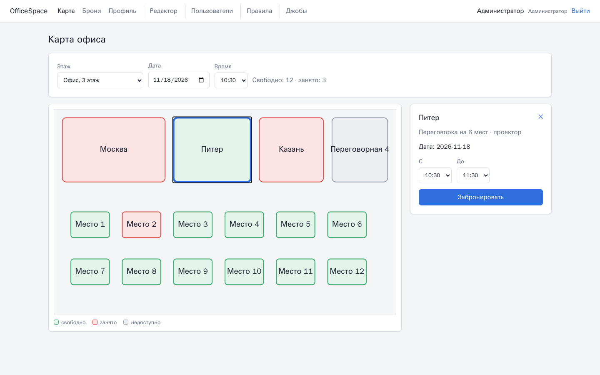
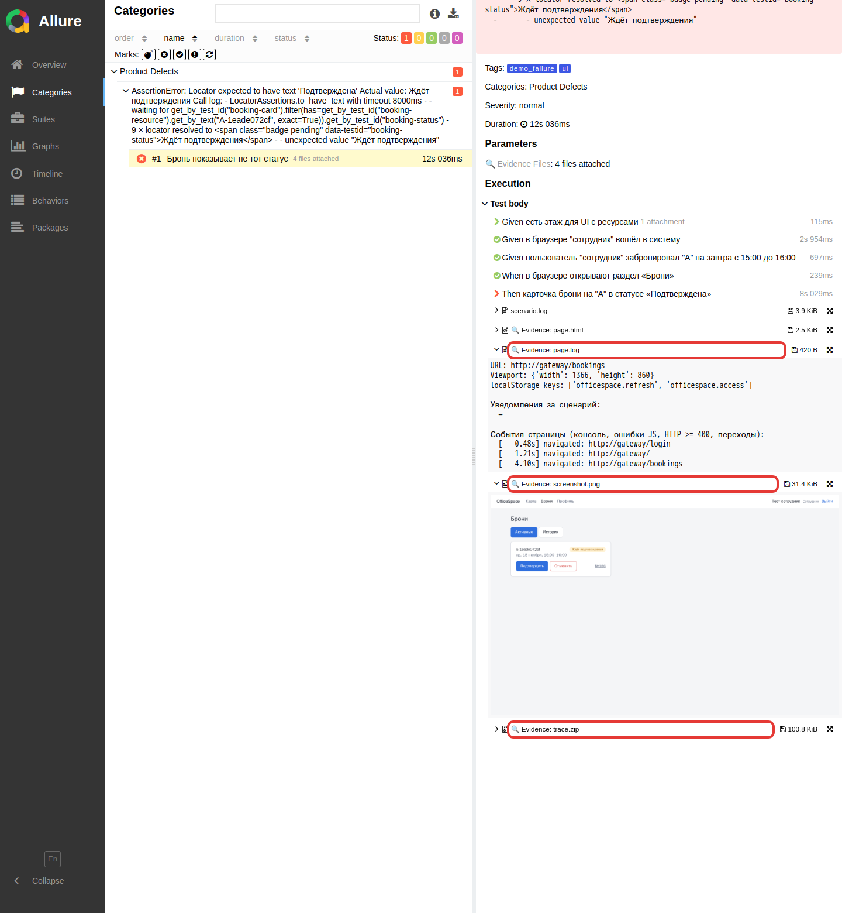

# room-booking-qa

Учебный стенд для автотестов: **OfficeSpace**, сервис бронирования переговорок и рабочих мест в офисе (микросервисы на FastAPI и PostgreSQL за nginx), и **BDD-фреймворк автотестов** к нему на Behave.

Приложение написано специально как мишень для тестирования: в нём есть роли и права, JWT с ротацией refresh-токенов, гонки за один ресурс, глобальные правила, оптимистическая блокировка, события через RabbitMQ, письма, Telegram-бот, планировщик джоб и внешняя интеграция с производственным календарём.



## Архитектура

```
браузер ─► gateway (nginx :8080)            /api/*/internal/* наружу закрыт (404)
             ├── /                ──► web (Vue 3 SPA)
             ├── /api/auth/*      ──► auth ──────┐
             ├── /api/booking/*   ──► booking ───┤  outbox ──► RabbitMQ (topic officespace.events)
             ├── /api/tg/*        ──► tgbot ─────┘                ├──► notifier ──► SMTP ──► Mailpit
             └── /api/scheduler/* ──► scheduler                   └──► tgbot ──► Telegram Bot API (заглушка)
                                         │
                                         └── /internal/jobs/* (сервисный токен) ──► booking, auth
booking ──► производственный календарь (заглушка)
все сервисы ──► PostgreSQL 16, у каждого своя схема

auth выпускает JWT, остальные проверяют подпись общим секретом и берут права из токена
```

| Сервис | Что делает |
|---|---|
| `auth` | регистрация, вход, access + refresh JWT с ротацией и отзывом цепочки при повторном использовании, роли и права, журнал входов, блокировка после 5 неудачных попыток |
| `booking` | этажи и план, переговорки (слоты по 30 минут) и рабочие места (на рабочие дни по времени офиса), брони `pending → confirmed → checked_in`, `expired`, `cancelled`, `no_show`, правила бронирования, карта занятости, производственный календарь, джобы просрочки, напоминаний и неявок |
| `notifier` | воркер: события → письма по шаблонам, идемпотентность через `processed_events` |
| `tgbot` | привязка Telegram одноразовым кодом, уведомления с кнопками «Подтвердить», «Отменить», «Я на месте», команда `/my` |
| `scheduler` | расписание джоб (APScheduler), ручной запуск через API, не даёт одной джобе идти в два потока |
| `stubs` | заглушки Telegram Bot API и источника календаря, тесты управляют ими (сбой, мусор, медленный ответ) |
| `web` | SPA на Vue 3 + TypeScript: карта этажа в SVG со свободными и занятыми местами, бронь с карты, список броней с подтверждением и отменой, профиль с привязкой Telegram, редактор этажа с перетаскиванием мышью, админка (пользователи, правила, джобы); адаптивная вёрстка под телефон |
| `gateway` | единая точка входа, Swagger: `/api/auth/docs`, `/api/booking/docs`, `/api/tg/docs`, `/api/scheduler/docs` |
| инфраструктура | PostgreSQL 16, RabbitMQ (UI `:15672`), Mailpit (UI `:8025`) |

Права приходят в access-токене, каждый сервис проверяет их сам (`require("bookings.read_all")`). Роли: `employee`, `manager`, `facility` (АХО), `admin`.

От двойной брони защищают два уровня: блокировка строки ресурса (`SELECT … FOR UPDATE`) и ограничение `EXCLUDE USING gist` в PostgreSQL, которое не даст пересечься двум активным броням даже в обход API.

События публикуются через **transactional outbox**: запись в таблицу outbox идёт в той же транзакции, что и данные, отдельный поток отправляет её в брокер с подтверждением доставки. Доставка «как минимум один раз», поэтому потребители идемпотентны. Временная ошибка — повтор (до 3 раз), битое сообщение — сразу в очередь недоставленных `<очередь>.dlq`.

Подробности и план развития — в [docs/ARCHITECTURE.md](docs/ARCHITECTURE.md).

## Автотесты

```
tests/
├── features/                 # сценарии на русском Gherkin
│   ├── auth/                 # регистрация, вход, токены, матрица прав, сброс пароля
│   ├── booking/              # переговорки, места, гонки, просрочка, чек-ин и неявки, календарь, правила
│   ├── notifications/        # письма о событиях, дубли и DLQ
│   ├── telegram/             # бот: привязка, кнопки, команды
│   ├── platform/             # планировщик, закрытый внутренний API
│   ├── ui/                   # браузерные сценарии (Playwright): вход, карта, брони, редактор, права, телефон
│   ├── demo/                 # нарочно падающий сценарий: как выглядит падение в отчёте (в прогон не входит)
│   ├── steps/                # шаги
│   └── environment.py        # хуки: клиенты, участники, снимок и откат правил
├── framework/
│   ├── http.py               # HTTP-коннектор: каждый запрос и ответ пишется в лог сценария
│   ├── db.py                 # коннектор к PostgreSQL: проверки и подготовка состояния
│   ├── api.py                # клиенты сервисов (только пути и тела)
│   ├── infra.py              # Mailpit, RabbitMQ management API, заглушки; wait_until вместо sleep
│   ├── models.py             # контракты ответов (pydantic, extra="forbid")
│   ├── ui/                   # Playwright: браузер на процесс, page objects по data-testid, артефакты падений
│   ├── actors.py             # участники по ярлыку: «сотрудник 2», «руководитель», «АХО»
│   └── data.py               # уникальные данные, «завтра», «через 3 дн.» по времени офиса
├── config/                   # окружения: docker (внутри compose) и local (с хоста)
├── tools/capture_docs.py     # скриншоты для инструкции с рамкой вокруг нужного элемента
└── run.sh                    # два прохода: параллельный и последовательный для @serial
```

### Как устроен фреймворк

Сценарий на русском Gherkin → шаг → помощники (`actors`, `support`) → клиенты сервисов, page objects, коннекторы к БД и инфраструктуре → один HTTP-клиент и один браузер на процесс. Каждый слой знает только о нижнем: в `.feature` нет URL и селекторов, в шагах нет путей API, в клиентах API нет проверок.

- **Участники по ярлыку.** «сотрудник 2», «руководитель», «АХО» в тексте сценария создаются при первом упоминании с нужной ролью и уникальным email.
- **Контракты.** Любой ответ разбирается в pydantic-модель с `extra="forbid"`: новое или пропавшее поле роняет тест.
- **Наблюдаемость.** Каждый HTTP-запрос и ответ, каждый SQL пишутся в лог сценария и попадают во вложения Allure. Упавший UI-сценарий оставляет скриншот, трассу Playwright, журнал страницы (уведомления, ошибки JS, ответы 4xx/5xx) и HTML.
- **Ожидания без `sleep`.** Письма, сообщения бота и события ждём опросом с таймаутом, UI — через `expect` Playwright.
- **Изоляция вместо порядка.** Сценарии не зависят друг от друга и идут параллельно. Общее состояние меняют только сценарии `@serial`, и хуки возвращают его после них.
- **Защита от пустого прогона.** Опечатка в теге не даёт «зелёный» прогон без сценариев: `run.sh` падает, если ничего не выполнилось.

Пошаговая инструкция со скриншотами: запуск, чтение отчёта, разбор падения по трассе, новый сценарий — в [docs/FRAMEWORK.md](docs/FRAMEWORK.md).



154 сценария (128 API и 26 UI), полный прогон с чистого стенда — около минуты.

Что показывают сценарии:

- **Права**: матрица «роль × действие» по обоим сервисам через `Структура сценария`; новая роль начинает действовать только после перевыпуска токена.
- **JWT**: просроченный токен, чужая подпись, refresh вместо access, повторное использование refresh отзывает всю цепочку (проверка в БД).
- **Гонки**: 10 потоков одновременно бронируют одно время, проходит ровно один; прямая вставка в БД упирается в `EXCLUDE`.
- **Время**: брони мест по времени офиса (Europe/Moscow) при UTC в базе; граничные случаи пересечений («вплотную можно»).
- **Джобы**: бронь «стареет» через `UPDATE created_at` в БД, затем запускается джоба просрочки.
- **Оптимистическая блокировка**: правка ресурса с устаревшей версией получает 409.
- **Контракты**: каждый ответ валидируется pydantic-моделью; новое поле в ответе роняет тест.
- **Асинхронные цепочки**: действие в API → событие в RabbitMQ → письмо в Mailpit (ссылка сброса пароля берётся прямо из письма) или сообщение бота в заглушке Telegram. Ожидание через опрос с таймаутом, без слепых `sleep`.
- **Брокер**: событие публикуется напрямую через management API RabbitMQ: дубль не даёт второго письма, битое сообщение оказывается в DLQ.
- **Telegram**: тест «пишет» боту и «жмёт» инлайн-кнопки через заглушку Bot API; кнопка чужой брони или из непривязанного чата отклоняется.
- **Время относительно «сейчас»**: напоминания, окно чек-ина и неявки проверяются сдвигом брони в БД и ручным запуском джоб через планировщик.
- **UI (Playwright)**: page objects по `data-testid`; вход без формы через токены в `localStorage` (форму проверяют свои сценарии); результат действия в браузере сверяется по API. Браузер нарочно в часовом поясе Новосибирска, а офис в Москве: бронь «10:00» должна оказаться 10:00 по офису. Перетаскивание ресурса мышью в редакторе с пересчётом экранных пикселей в единицы плана, конфликт версий при одновременной правке, скрытые и закрытые по адресу разделы, вёрстка на экране 375×812 без горизонтальной прокрутки. При падении — скриншот, трасса Playwright, журнал страницы и HTML во вложениях Allure и в `reports/ui-failures`.
- **Внешняя интеграция**: заглушка календаря отдаёт праздник и рабочую субботу; при сбое или мусоре от источника джоба падает с 502, а уже загруженный календарь остаётся.

### Изоляция и параллельность

- Каждый сценарий создаёт своих пользователей и ресурсы с уникальными именами, поэтому сценарии не зависят друг от друга и идут параллельно (BehaveX, по сценариям).
- Сценарии с тегом `@serial` меняют общее состояние и идут вторым, последовательным проходом. `@settings` — глобальные правила: снимаются перед сценарием и возвращаются после, шаг, меняющий правила, без тега падает сразу. `@calendar` — производственный календарь: после сценария заглушка сбрасывается и календарь синхронизируется заново.
- Рабочие места бронируются на «ближайшую рабочую неделю», найденную по календарю сервиса, поэтому сценарии не ломаются от даты запуска и праздников.
- У каждого участника свой Telegram-чат со случайным id, письма ищутся по уникальному адресу: параллельные сценарии не видят чужих сообщений.
- UI-сценарии: один Chromium на процесс, свой контекст браузера (чистые cookies и `localStorage`) на сценарий и свой маленький этаж, чтобы план был читаемым.
- Тестовые ресурсы раскладываются по сетке на одном этаже на процесс: меньше лишних запросов, никаких пересечений.

## Запуск

Нужен только Docker.

```bash
docker compose up -d --build --wait     # сервисы
docker compose run --rm tests           # все тесты: отчёты в reports/
docker compose run --rm tests sh run.sh -t @auth          # только auth
docker compose run --rm tests sh run.sh -t @ui            # только браузерные сценарии
docker compose run --rm tests behave features/booking/race.feature   # один файл обычным behave
docker compose run --rm allure                            # HTML-отчёт: reports/allure-report/index.html
```

Веб-интерфейс: http://localhost:8080 (администратор `admin@officespace.test` / `Admin12345`). Для разработки фронтенда: `cd web && npm install && npm run dev` (vite проксирует `/api` на gateway).

Отчёты: `reports/allure-results` (сырые результаты Allure; к каждому сценарию приложен лог HTTP-запросов и SQL), `reports/allure-report/index.html` (готовый отчёт одним файлом), `reports/ui-failures/` (артефакты упавших UI-сценариев). Как их читать — в [docs/FRAMEWORK.md](docs/FRAMEWORK.md).

## CI

GitHub Actions ([.github/workflows/tests.yml](.github/workflows/tests.yml)): поднимает compose, гоняет тесты в контейнере, сохраняет отчёты и логи сервисов как артефакты, на `main` публикует Allure-отчёт с историей на GitHub Pages.

## Стек

Python 3.12 · FastAPI · Vue 3 · TypeScript · Vite · Playwright · SQLAlchemy 2 · PostgreSQL 16 · RabbitMQ (pika) · APScheduler · Mailpit · PyJWT · nginx · Docker Compose · Behave · BehaveX · pydantic · psycopg2 · Allure · GitHub Actions
