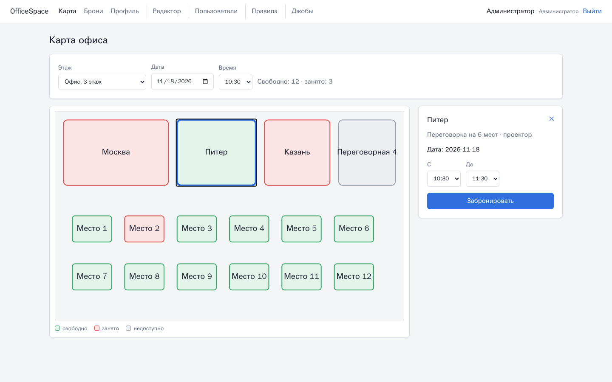
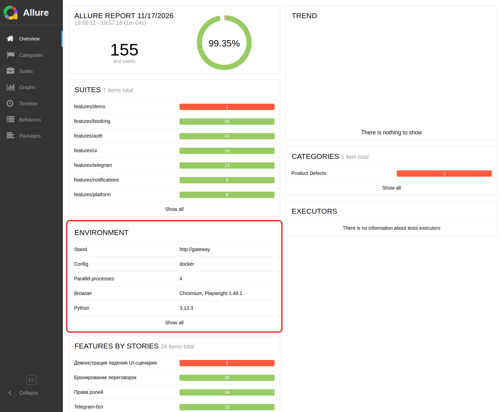
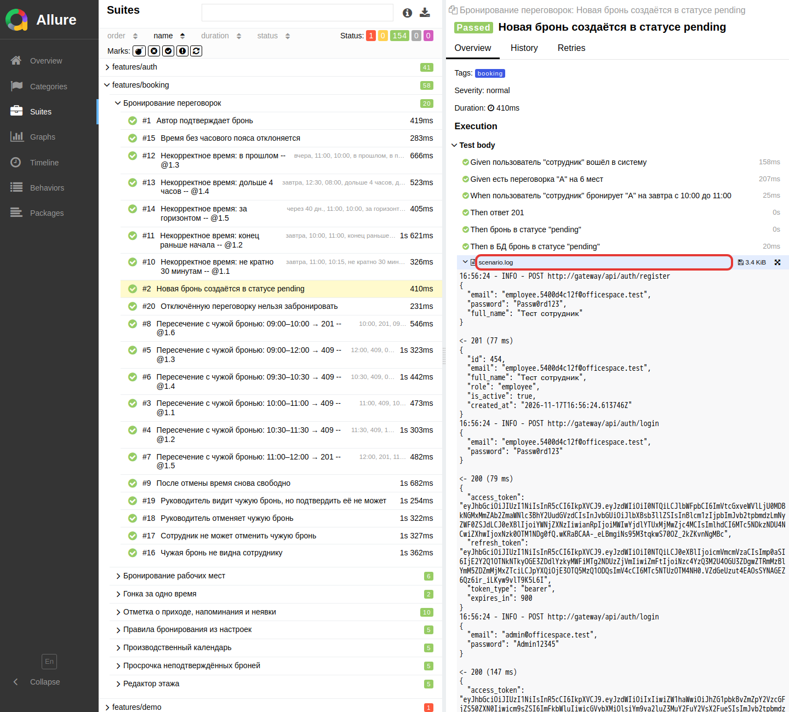
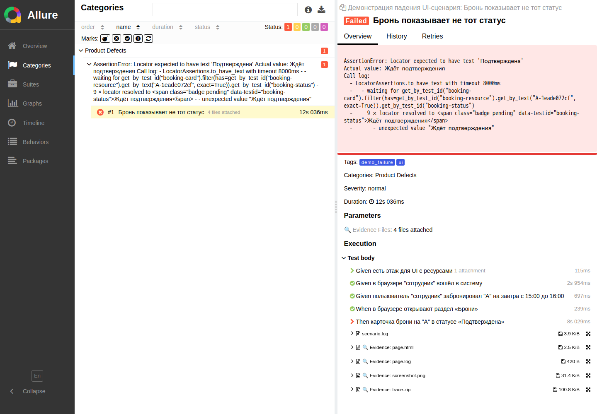
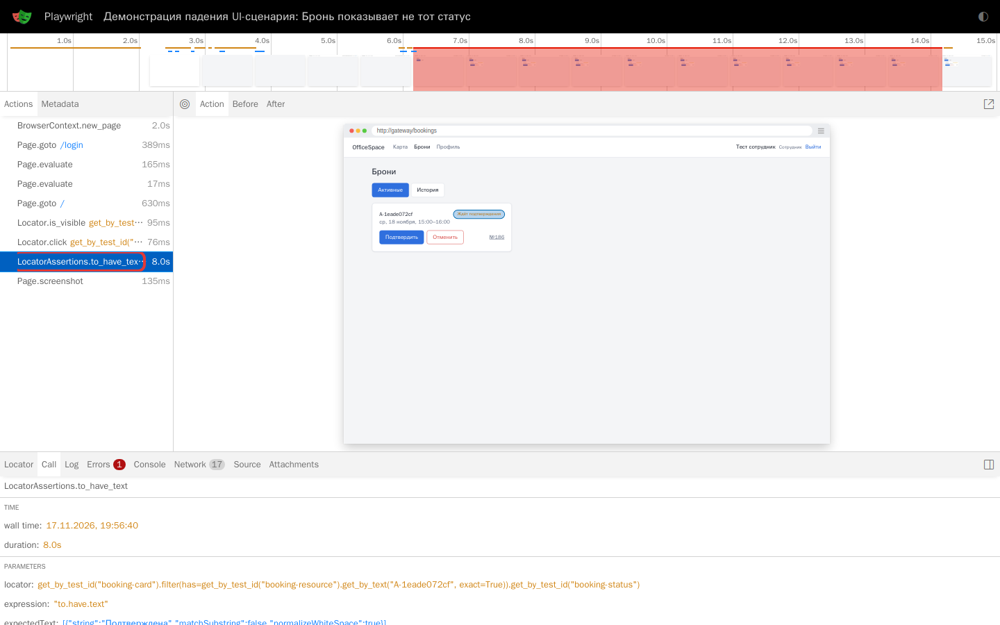

# Фреймворк автотестов: инструкция

Как запустить тесты, где смотреть результат, как разобрать падение и как добавить свой сценарий.
Всё выполняется в Docker: на машине не нужны ни Python, ни браузеры.



- [Как устроен фреймворк](#как-устроен-фреймворк)
- [Запуск](#запуск)
- [Отчёт Allure](#отчёт-allure)
- [Разбор упавшего UI-сценария](#разбор-упавшего-ui-сценария)
- [Новый сценарий: пошагово](#новый-сценарий-пошагово)
- [Теги](#теги)
- [Настройки и переменные окружения](#настройки-и-переменные-окружения)
- [Запуск с хоста и отладка в окне браузера](#запуск-с-хоста-и-отладка-в-окне-браузера)
- [CI](#ci)
- [Как обновить скриншоты этой инструкции](#как-обновить-скриншоты-этой-инструкции)

## Как устроен фреймворк

Слои сверху вниз. Каждый слой знает только о нижнем:

```
features/*.feature          сценарии на русском Gherkin: что проверяем, языком предметной области
        │
features/steps/*.py         шаги: связывают фразу с действием, держат состояние сценария в context
        │
framework/actors.py         участники по ярлыку: «сотрудник 2», «руководитель», «АХО» → пользователь с ролью
framework/support.py        общие помощники шагов: проверка статуса, разбор в модель, даты по времени офиса
        │
framework/api.py            клиенты сервисов: только пути и тела запросов, без проверок
framework/ui/pages.py       page objects: элементы по data-testid, действия пользователя
framework/infra.py          Mailpit, RabbitMQ, заглушки Telegram и календаря; wait_until вместо sleep
framework/prepare.py        предусловия пачкой INSERT … RETURNING в одной транзакции вместо цепочки API
framework/cleanup.py        уборка за сценарием: созданное узнаётся по ответам API и SQL-подготовке
framework/locks.py          блокировки общего состояния (правила, календарь) между параллельными сценариями
framework/pause.py          пауза перед уборкой для ручной проверки (PAUSE=fail|always)
framework/db.py             PostgreSQL: проверки, транзакции подготовки и уборки
        │
framework/http.py           один HTTP-клиент на всё: лог запроса с curl-командой, повторы на 502/503/504
framework/ui/browser.py     Chromium на процесс, контекст на сценарий, трасса и артефакты падения
framework/models.py         контракты ответов на pydantic (extra="forbid": лишнее поле роняет тест)
framework/config.py         окружение из config/<TEST_ENV>.yaml, переменные окружения перекрывают
```

Хуки `features/environment.py` создают клиенты один раз на процесс. Жизнь сценария:

1. **До первого шага** берутся блокировки общего состояния, которые нужны сценарию, и обнуляется его
   состояние: участники, ресурсы, брони, браузерный контекст.
2. **Шаги.** Предусловия («Дано») пишутся в БД, проверяемые действия идут через API или браузер.
3. **После сценария** по порядку: пауза для ручной проверки (если включена), артефакты упавшего
   UI-сценария, откат правил и календаря, уборка созданного. Блокировки снимаются последними, чтобы
   соседи не увидели изменённые правила до отката.

Что делали хуки (сколько ждали блокировок, что убрали), лежит во вложении `hooks.log` у каждого сценария.

Главные принципы:

- **Сценарий не зависит от соседей.** Каждый создаёт своих пользователей и ресурсы с уникальными именами.
  Поэтому весь набор идёт одним параллельным проходом по сценариям (BehaveX, 4 процесса).
- **Общее состояние — под блокировкой.** Глобальные правила (`@settings`) и календарь (`@calendar`) сценарий
  меняет под монопольной блокировкой, а сценарии, которые от них зависят, держат совместную. Пока правило
  изменено, ждут только зависимые сценарии; вход, токены и доставка событий идут дальше. Подробно — ниже.
- **За собой убирают.** Всё, что сценарий создал, удаляется после него. Прогон не копит в БД тысячи
  пользователей и ресурсов, и стенд после прогона такой же, как до него.
- **Предусловие — не проверка.** «Дано пользователь вошёл» не должно тратить время на регистрацию через API:
  предусловия пишутся прямо в БД, через API идёт только то, что сценарий проверяет.
- **Проверка там, где правда.** UI-действие сверяется по API, ответ API — по БД. Письмо ищется в Mailpit,
  сообщение бота — в заглушке Telegram.
- **Без `sleep`.** Асинхронные эффекты ждём опросом с таймаутом (`wait_until`, `expect` в Playwright).
- **Контракт проверяется всегда.** Любой ответ разбирается в pydantic-модель, поэтому новое или пропавшее
  поле видно сразу.

## Механизмы

### Блокировки общего состояния (`framework/locks.py`)

Правила бронирования и производственный календарь — одни на весь стенд. Раньше сценарии, которые их
меняют, шли отдельным последовательным проходом после параллельного. Теперь все сценарии идут вместе:

| Сценарий | Блокировка |
|---|---|
| `@settings` (меняет правила) | «settings» монопольно, «calendar» совместно |
| `@calendar` (меняет календарь) | «calendar» монопольно, «settings» совместно |
| бронирует или зависит от правил | обе совместно |
| `@auth`, `@messaging` без `@booking` | не нужны |

Это блокировка «читатели — писатель» на `flock`: все процессы BehaveX работают в одном контейнере и видят
одну папку `LOCK_DIR`. Перед самой блокировкой стоит турникет: писатель занимает его на время ожидания,
и новые читатели встают за ним в очередь. Без турникета при плотном потоке читателей писатель ждал бы
бесконечно. Блокировки берутся всегда в одном порядке, поэтому взаимной блокировки не бывает. Если
блокировку не получить за `LOCK_TIMEOUT` секунд, сценарий падает с понятной ошибкой и не висит молча.

Набор, который нужен сценарию, определяет одна функция `plan(tags)`. Новое общее состояние добавляется
строкой в `SHARED_STATE` и тегом с тем же именем.

### Подготовка предусловий в БД (`framework/prepare.py`)

Регистрация через API — это хеш пароля, событие в outbox, приветственное письмо, а для роли ещё и второй
запрос. Сценарию, который проверяет бронь, всё это не нужно. Поэтому пользователи, ресурсы и этажи из шагов
«Дано» копятся в пачку и пишутся `INSERT … RETURNING` одной транзакцией. Этаж для UI-сценария со всеми
ресурсами — тоже одна транзакция: ресурс ссылается на этаж из той же пачки.

- Хеш общего тестового пароля берётся у пользователя, зарегистрированного через API (один раз на процесс):
  формат хеша остаётся заботой сервиса, тесты его не повторяют.
- Где побочный эффект и есть проверка (приветственное письмо), предусловие явно идёт через API:
  шаг `пользователь "X" зарегистрировался через API`.
- `PREPARE_VIA=api` возвращает старый путь целиком: для сравнения и на случай, если схема разъехалась с кодом.

Замер на полном наборе (154 сценария, 214 шагов-предусловий):

| Подготовка | Шаги-предусловия, всего | В среднем на шаг | Весь прогон |
|---|---|---|---|
| через API (`PREPARE_VIA=api`) | 24,2 с | 113 мс | 30,3 с |
| через БД | 17,9 с | 83 мс | 27,6 с |

Вход в систему по-прежнему идёт через API: токен выдаёт сервис, и пароль он проверяет сам. Это и есть
оставшиеся ~80 мс на шаге «вошёл в систему».

### Уборка (`framework/cleanup.py`)

Шаги ничего не регистрируют руками. Созданное узнаётся само: по успешным ответам `POST /register`,
`/floors`, `/resources` (и из тестов, и из браузера — UI-сессия запоминает ответы страницы) и по строкам
SQL-подготовки. После сценария всё удаляется одной транзакцией, от зависимых строк к главным: брони,
ресурсы, этажи, привязки Telegram, пользователи. Удаляется только своё, поэтому уборка безопасна в
параллельном прогоне. Общий тестовый этаж процесса убирается в `after_all`.

Проверка: число пользователей, этажей, ресурсов и броней в БД до и после полного прогона одинаковое.
`KEEP_DATA=1` оставляет данные на стенде, чтобы посмотреть, что сценарий после себя оставил.

### HTTP: curl в логе и повторы (`framework/http.py`)

Под каждым запросом в `scenario.log` — готовая curl-команда: запрос из упавшего теста повторяется
копированием в терминал (с хоста — заменив `http://gateway` на `http://localhost:8080`).

Повторы — только там, где они не меняют смысл проверки: нет соединения (сервис перезапускается)
и 502/503/504 от gateway на идемпотентных методах. POST по ответу не повторяется: повтор создал бы вторую
бронь, и тест проверял бы уже не то. Ответ 4xx или 500 не повторяется никогда — это результат проверки.

### Пауза для ручной проверки (`framework/pause.py`)

`PAUSE=fail` останавливает упавший сценарий перед уборкой, `PAUSE=always` — каждый. В терминале
печатаются стенд, логины и пароли участников и ресурсы сценария: можно зайти в браузере и посмотреть
своими глазами. Продолжить — `touch reports/continue`; через `PAUSE_TIMEOUT` минут (30) прогон
продолжит сам, чтобы забытая пауза не держала блокировки и стенд.

```bash
docker compose run --rm -e PAUSE=fail -e PARALLEL=1 tests sh run.sh -t @booking
```

## Запуск

```bash
docker compose up -d --build --wait                         # стенд: сервисы, БД, брокер, веб
docker compose run --rm tests               # весь набор (≈ 1 минута)
docker compose run --rm tests sh run.sh -t @booking     # по тегу
docker compose run --rm tests sh run.sh -t @ui          # только браузерные
docker compose run --rm tests sh run.sh -t "@auth and not @ui"
docker compose run --rm tests behave features/booking/race.feature   # один файл без BehaveX
docker compose run --rm allure              # собрать HTML-отчёт Allure
```

`run.sh` запускает один параллельный проход. Выборку можно задать аргументами BehaveX или переменными
`TAGS` и `EXCLUDE` (их заполняет форма ручного запуска в CI):

```bash
docker compose run --rm -e TAGS=@booking -e EXCLUDE=ui,jobs tests
```

Если по тегам не нашлось ни одного сценария, прогон падает с кодом 3 и не выдаёт пустой прогон
за успешный. Например, так ловится опечатка `-t @atuh`.

Что появляется в `reports/`:

| Путь | Что там |
|---|---|
| `allure-results/` | сырые результаты для Allure |
| `allure-report/index.html` | готовый отчёт одним файлом, открывается двойным щелчком (после `run --rm allure`) |
| `ui-failures/<фича>-<сценарий>/` | скриншот, трасса, журнал страницы и HTML упавших UI-сценариев |
| `run/` | служебный вывод BehaveX: `report.json`, JUnit XML, список упавших сценариев |

## Отчёт Allure

На главной странице видны итог прогона, разбивка по папкам фич и блок **Environment**: стенд, конфиг,
число процессов, версии браузера и Python, коммит (в CI).



У каждого сценария, в том числе зелёного, во вложениях есть `scenario.log`. Это полный лог HTTP-запросов
(метод, URL, тело) и ответов (статус, время, тело), а также SQL-запросы к базе. По нему видно, что именно
тест отправил и что получил, без повторного запуска.



Упавшие сценарии собраны на вкладке **Categories** и сгруппированы по тексту ошибки. Сверху видно
сообщение проверки: что ожидалось, что пришло и какой локатор искали.



## Разбор упавшего UI-сценария

Посмотреть всё вживую можно на сценарии, который падает нарочно: он ждёт статус «Подтверждена» у брони,
которую никто не подтверждал. В обычный прогон он не входит.

```bash
docker compose run --rm tests sh run.sh -t @demo_failure
docker compose run --rm allure
```

Упавший UI-сценарий оставляет четыре вложения. Они есть в Allure и лежат в `reports/ui-failures/`:

| Файл | Зачем |
|---|---|
| `screenshot.png` | вся страница в момент падения |
| `trace.zip` | трасса Playwright: каждое действие со снимком DOM до и после, сеть, консоль |
| `page.log` | адрес, размер окна, все показанные уведомления (они исчезают через несколько секунд и на скриншот не попадают), ошибки JS, ответы HTTP 4xx/5xx, переходы между страницами |
| `page.html` | разметка страницы в момент падения |


Трасса записывается у каждого UI-сценария, а сохраняется только у упавшего. Её можно открыть так:

```bash
docker compose run --rm -p 9323:9323 tests \
  playwright show-trace --host 0.0.0.0 --port 9323 "/reports/ui-failures/<папка сценария>/trace.zip"
# затем открыть http://localhost:9323
```

Второй способ — перетащить `trace.zip` на https://trace.playwright.dev (файл не уходит с машины, его
читает браузер). Слева список действий, упавшее отмечено красным. В середине снимок страницы на этот
момент. Снизу параметры вызова, ожидаемое и полученное значение, вкладки Console и Network.



Порядок разбора:

1. Прочитать текст ошибки в Allure. Обычно уже видно, что ожидалось и что пришло.
2. Посмотреть `screenshot.png`. Был ли нужный элемент на экране?
3. Открыть `page.log`. Нет ли ошибок JS или ответов 4xx/5xx, какое уведомление показал интерфейс?
4. Если непонятно, как страница пришла в это состояние, открыть трассу и пройти по шагам.
5. Сверить с `scenario.log`. Какие данные сценарий подготовил через API?

## Новый сценарий: пошагово

Пример: «руководитель видит в календаре брони всего офиса». Действуем сверху вниз и пишем код только там,
где его ещё нет.

**1. Сценарий.** Сначала проверьте, нет ли нужных фраз в готовых шагах:
`grep -rn "@step" tests/features/steps/`. Большинство «Дано» уже есть.

```gherkin
# tests/features/booking/calendar_view.feature
# language: ru
@booking
Функция: Календарь броней

  Сценарий: Руководитель видит брони всего офиса
    Дано пользователь "сотрудник" забронировал "A" на завтра с 10:00 до 11:00
    Когда пользователь "руководитель" запрашивает календарь на завтра
    Тогда ответ 200
    И в календаре есть бронь на "A" с 10:00 до 11:00
```

**2. Клиент API** (`framework/api.py`), если метода ещё нет. Только путь и тело, без проверок:

```python
def calendar(self, token: str, date_from: str, date_to: str) -> Response:
    return self._call("GET", "/calendar", token=token, params={"date_from": date_from, "date_to": date_to})
```

**3. Модель ответа** (`framework/models.py`). Наследник `Contract`, поля ровно как в ответе сервиса.

**4. Шаги** (`features/steps/<область>_steps.py`). Участник берётся по ярлыку через `actor()` и создаётся
при первом упоминании. Даты по-русски разбирает `day_of()`. Статус проверяет `expect()`, модель —
`parse()`:

```python
@step('пользователь "{label}" запрашивает календарь на {day}')
def step_calendar(context, label, day):
    d = day_of(context, day).isoformat()
    context.resp = context.booking.calendar(actor(context, label).access_token, d, d)
```

**5. Запуск только нового файла:** `docker compose run --rm tests behave features/booking/calendar_view.feature`.

Правила, которые проверяет ревью:

- Пользователи и ресурсы в сценарии только свои, с уникальными именами (`data.unique_name`, `actor`).
- Сценарий меняет то, что видно всем (правила, календарь)? Тогда ставится тег `@settings` или `@calendar`:
  он даёт монопольную блокировку и откат после сценария. Без тега шаг смены правил падает сразу.
- Предусловие («Дано») создаётся через SQL-подготовку, если его побочные эффекты сценарию не нужны.
  Новый вид сущности добавляется в `prepare.py` и в `CREATED_BY`/`STATEMENTS` уборки.
- Асинхронный результат ждём через `wait_until`, а не `time.sleep`.
- UI-сценарий проверяет в браузере только видимое. Данные готовятся через API, итог сверяется по API.

### UI-сценарий

- Тег `@ui` (и `@mobile` для экрана 375×812). Хук сам создаст чистый контекст браузера, а страница будет в `context.page`.
- Вход без формы: `в браузере "сотрудник" вошёл в систему` кладёт токены в `localStorage`. Форму входа
  проверяют отдельные сценарии.
- Элементы ищутся только по `data-testid`. Если у нужного элемента его нет, атрибут добавляется во фронтенд,
  а не пишется CSS-селектор.
- Новый экран — новый класс в `framework/ui/pages.py` с методами-действиями. Шаги не трогают локаторы напрямую.
- Шаги браузера начинаются с «в браузере …», чтобы не путаться с API-шагами `пользователь "…" …`.
- Браузер нарочно живёт в часовом поясе Новосибирска, а офис в Москве. Время на экране должно быть
  офисным, иначе тест это поймает.

## Теги

| Тег | Что значит |
|---|---|
| `@auth`, `@booking`, `@notifications`, `@telegram`, `@platform`, `@admin`, … | область, для выборки |
| `@ui` | браузерный сценарий: хук поднимает контекст Playwright |
| `@mobile` | экран телефона 375×812, touch |
| `@settings` | меняет глобальные правила: монопольная блокировка, снимок до сценария, откат после |
| `@calendar` | меняет производственный календарь: монопольная блокировка, после сценария сброс заглушки и пересинхронизация |
| `@auth`, `@messaging` | без `@booking` не берут блокировок общего состояния |
| `@demo_failure` | нарочно падающий сценарий для этой инструкции, в обычный прогон не входит |
| `@instruction` | съёмка скриншотов для [инструкций пользователей](user-guide/README.md): только явно (`-t @instruction`), всегда в один процесс |

## Настройки и переменные окружения

Окружение выбирается `TEST_ENV` (`docker` по умолчанию, `local` для запуска с хоста) и читается из
`tests/config/<TEST_ENV>.yaml`. Переменные окружения перекрывают файл:

| Переменная | По умолчанию | Что делает |
|---|---|---|
| `TEST_ENV` | `docker` | какой файл из `tests/config/` взять |
| `BASE_URL`, `DB_HOST`, `MAILPIT_URL`, `STUBS_URL` | из yaml | адреса стенда |
| `PARALLEL` | `4` | процессов BehaveX |
| `TAGS`, `EXCLUDE` | пусто | выборка: тег-выражение и теги-исключения через запятую |
| `INCLUDE_DEMO` | пусто | `1` — добавить `@demo_failure` в полный прогон |
| `PREPARE_VIA` | `sql` | `api` — предусловия через API, как раньше |
| `KEEP_DATA` | пусто | `1` — не убирать за сценариями |
| `PAUSE`, `PAUSE_TIMEOUT` | пусто, `30` | `fail` / `always` — пауза перед уборкой; сколько минут ждать |
| `LOCK_DIR`, `LOCK_TIMEOUT` | `/tmp/officespace-locks`, `300` | где файлы блокировок; сколько секунд ждать |
| `HEADED` | пусто | любое значение — браузер с окном (для отладки с хоста) |
| `UI_ARTIFACTS_DIR` | `/reports/ui-failures` | куда класть артефакты упавших UI-сценариев |
| `INSTR_DIR` | `/reports/instructions` | куда сценарии `@instruction` кладут снимки; для docs — `/docs/user-guide/img` |

## Запуск с хоста и отладка в окне браузера

Стенд пробрасывает порты наружу, поэтому тесты можно гонять из IDE:

```bash
cd tests
python -m venv .venv && . .venv/bin/activate      # Windows: .venv\Scripts\activate
pip install -r requirements.txt
playwright install chromium
TEST_ENV=local HEADED=1 behave features/ui/booking.feature -n "Пересечение"
```

С `HEADED=1` видно окно Chromium. Точку останова можно ставить прямо в шаге. На Windows без WSL
нет `flock`, поэтому блокировки выключаются с предупреждением: для одного процесса `behave` они не нужны,
а параллельный прогон идёт в контейнере.

## CI

`.github/workflows/tests.yml` запускается на push в `main`, на pull request и вручную:

1. собирает и поднимает стенд (`docker compose up --wait`);
2. гоняет набор в контейнере `tests`;
3. сохраняет артефакты: `reports/` (включая `ui-failures`) и логи всех сервисов;
4. после push в `main` собирает Allure с историей прошлых прогонов и публикует его на GitHub Pages.

Ручной запуск — форма **Actions → tests → Run workflow**:

| Поле | Что делает |
|---|---|
| Выборка | тег-выражение behave: `@auth`, `@booking and not @ui`; пусто — весь набор |
| Исключить теги | через запятую: `ui,jobs` |
| Добавить @demo_failure | показать в отчёте артефакты падения |
| Подготовка предусловий | `sql` или `api` — сравнить скорость |
| Параллельных процессов | 1, 2, 4, 6 |
| Опубликовать отчёт | выложить на Pages; иначе отчёт только в артефактах прогона, чтобы частичная выборка не затёрла отчёт по всему набору |

Значения формы передаются в контейнер через переменные окружения, а не подстановкой в команду:
текст из формы не исполняется оболочкой раннера.

## Как обновить скриншоты этой инструкции

Скриншоты снимает скрипт `tests/tools/capture_docs.py`. Он открывает сайт и отчёты в Playwright
и обводит нужное место красной рамкой. После изменений в интерфейсе или отчётах достаточно запустить заново:

```bash
docker compose run --rm -e INCLUDE_DEMO=1 tests sh run.sh   # прогон с упавшим демо-сценарием
docker compose run --rm allure
docker compose run --rm -v ./docs:/docs tests python tools/capture_docs.py
```

Снимки для инструкций пользователей делаются иначе — сценариями `@instruction` на живых данных, см.
[docs/user-guide/README.md](user-guide/README.md).

## Claude в проекте

`CLAUDE.md` в корне и `.claude/` — навыки, которыми Claude пишет автотесты, текстовые сценарии и
инструкции по этим правилам, и агент-ревьюер. Список и порядок работы — в [CLAUDE.md](../CLAUDE.md).
