<!--
Снимки: tests/features/instructions/booking.feature (тег @instruction), пересъёмка — см. README.md.
Слова — по glossary.md. Цифры правил — значения по умолчанию из раздела «Правила».
-->
# Бронирование переговорок и рабочих мест

Для сотрудника: как найти свободную переговорку или рабочее место, забронировать его, подтвердить
бронь и отменить, если планы поменялись.

Всё время на экранах — **время офиса** (Москва), даже если ваш компьютер в другом часовом поясе.

## Найти свободное

Откройте **Карту** в меню. Над планом выберите **Этаж**, **Дату** и **Время** — план покажет занятость
на этот момент, а рядом счётчик «Свободно: … · занято: …».

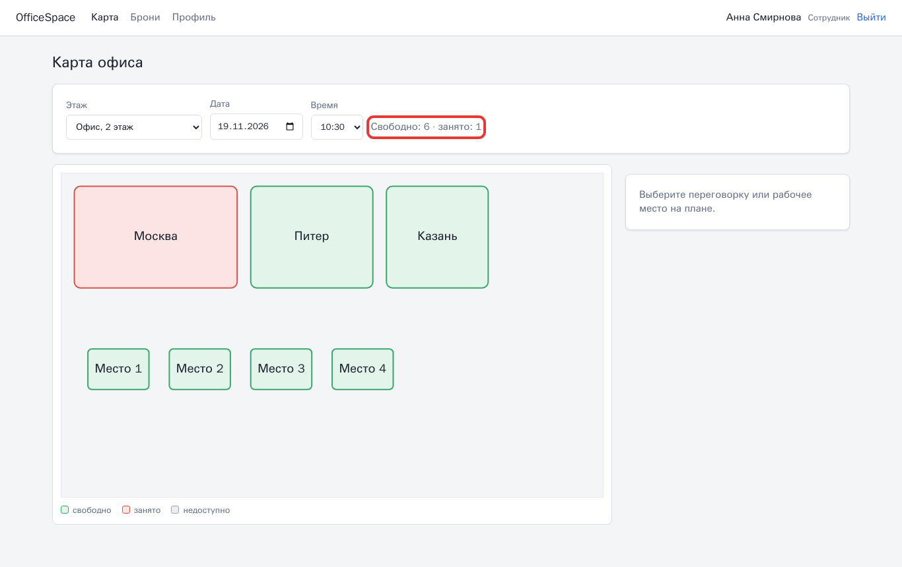

Цвет на плане:

- зелёный — свободно;
- красный — занято на выбранное время;
- серый — недоступно (переговорку отключили, забронировать нельзя).

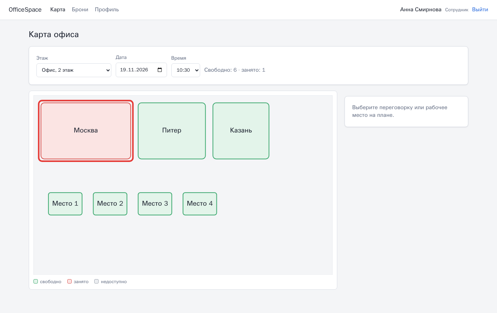

## Забронировать переговорку

1. Нажмите на переговорку на плане. Справа откроется панель бронирования: сколько в переговорке мест и
   какое в ней оборудование.
2. Выберите **С** и **До** — время идёт шагом в 30 минут, с 08:00 до 21:00.
3. Нажмите **«Забронировать»**.

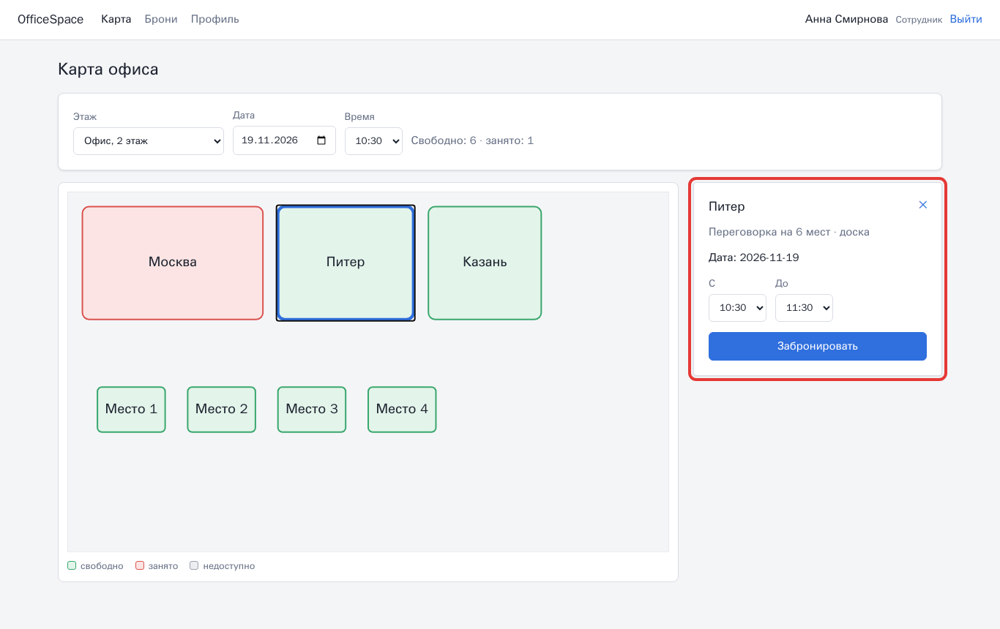

Под кнопкой появится «Бронь №… создана и ждёт подтверждения» и ссылка **«Открыть»**, переговорка на
плане станет красной.

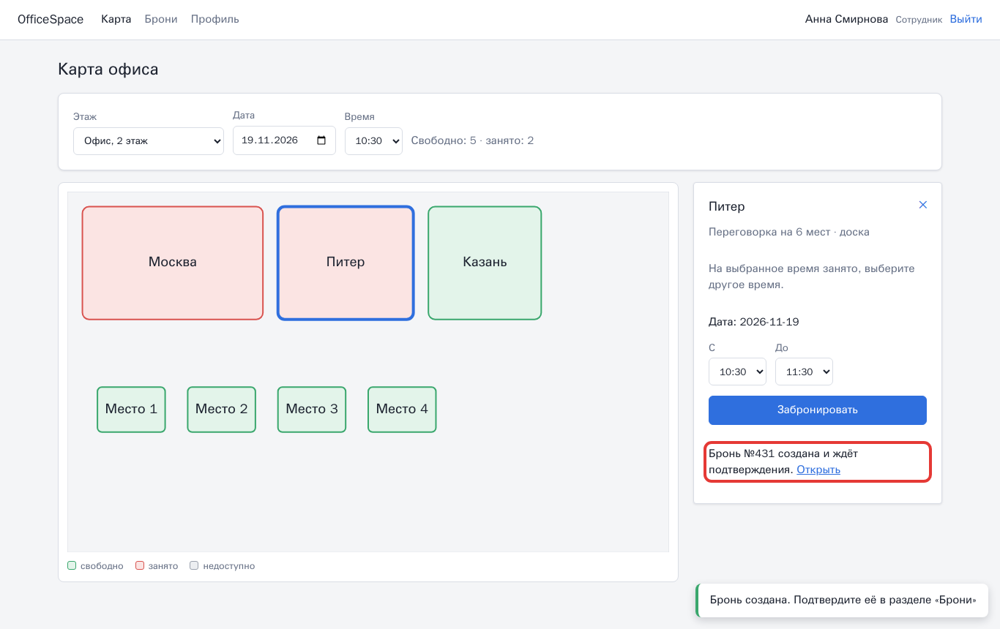

## Забронировать рабочее место

Рабочее место бронируется на целые дни, без времени.

1. Нажмите на место на плане.
2. Выберите **С** и **По** — первый и последний день.
3. Нажмите **«Забронировать»**.

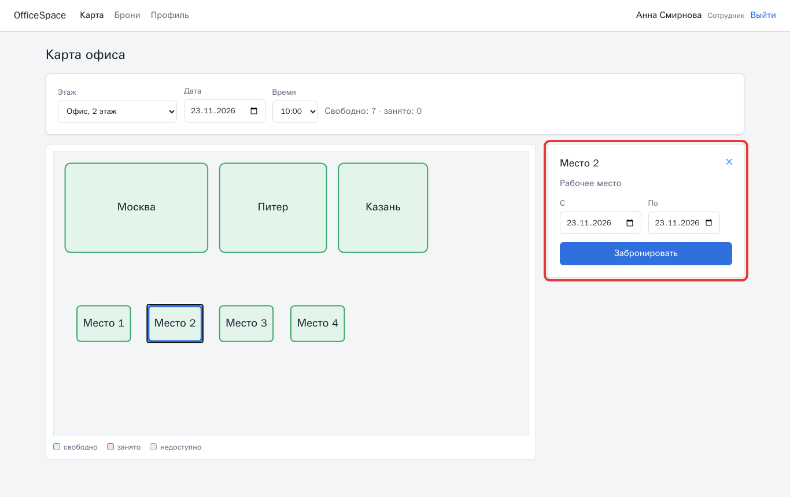

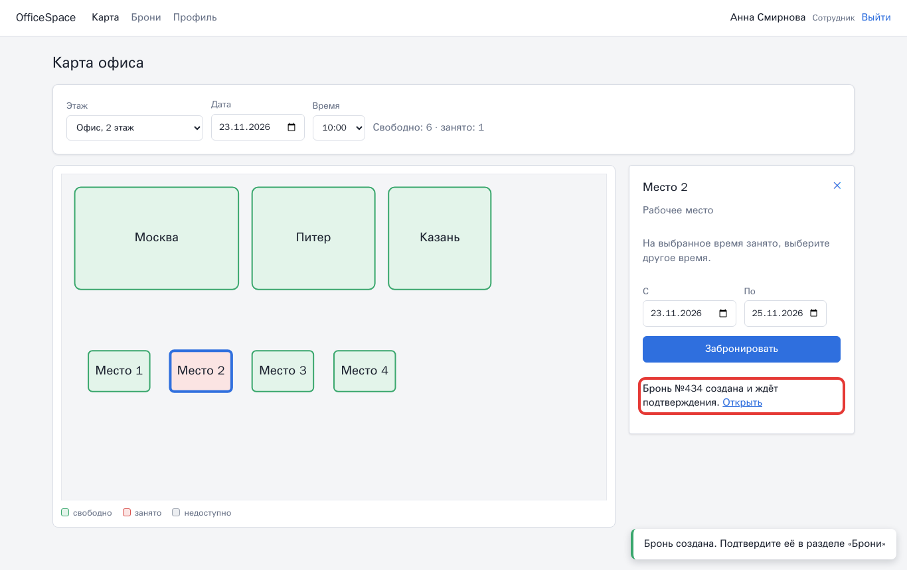

## Подтвердить бронь

Новая бронь в статусе «Ждёт подтверждения». Подтвердите её **в течение 15 минут**, иначе система
снимет её сама — статус станет «Не подтверждена вовремя», время освободится.

1. Откройте раздел **«Брони»**, вкладка **«Активные»**.
2. В карточке брони нажмите **«Подтвердить»**.

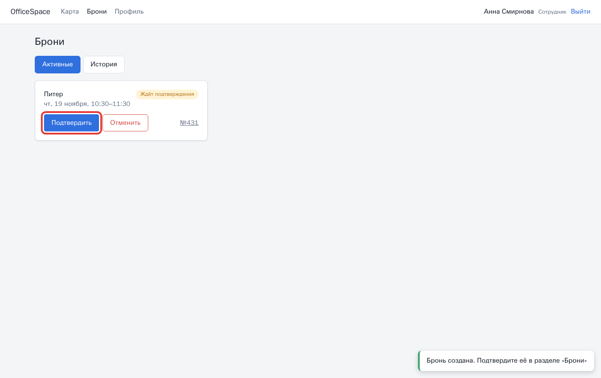

Появится уведомление «Бронь подтверждена», статус станет «Подтверждена».

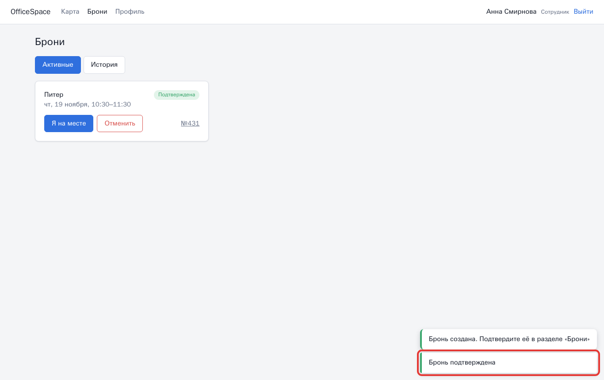

## Отметиться «Я на месте»

Когда пришли, нажмите в карточке брони **«Я на месте»**. Кнопка есть только у подтверждённой брони.

| Что | Окно отметки |
|---|---|
| Переговорка | с 10 минут до начала до 15 минут после начала |
| Рабочее место | с 23:50 накануне до 12:00 первого дня |

Не отметились в окне — бронь снимается со статусом «Неявка», время освобождается для других. За 30
минут до начала подтверждённой брони приходит напоминание на почту, а если в **Профиле** привязан
Telegram — и туда.

## Отменить бронь

1. Раздел **«Брони»**, вкладка **«Активные»**.
2. В карточке брони нажмите **«Отменить»**.

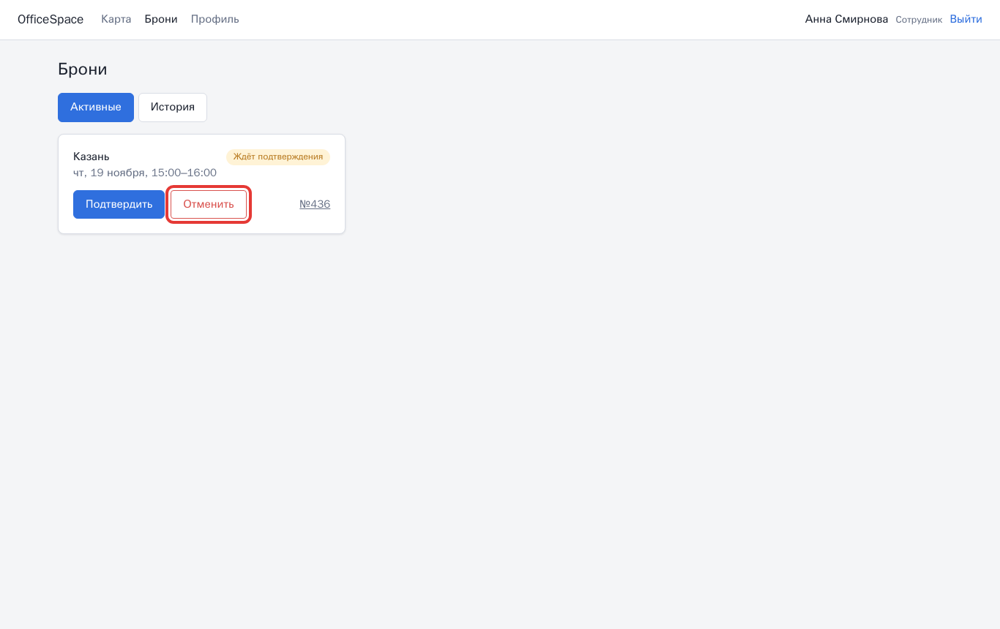

Появится уведомление «Бронь отменена». Бронь уйдёт на вкладку **«История»** со статусом «Отменена»,
время сразу освободится.

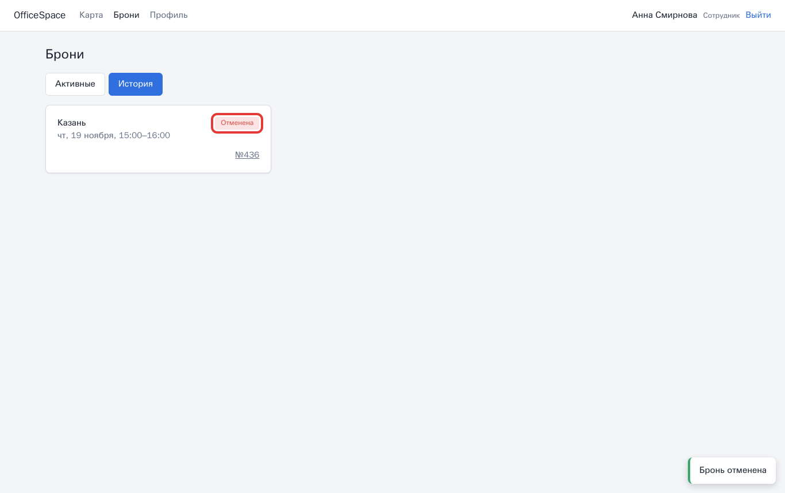

## Если не получилось

| Сообщение | Что значит | Что делать |
|---|---|---|
| Ресурс занят на это время | Кто-то уже забронировал переговорку или место на часть этого времени | Выбрать другое время или другую переговорку; занятость видна на плане |
| Превышен лимит активных броней (3) | У вас уже 3 брони, которые не закончились и не отменены | Отменить ненужную бронь |
| Бронь длиннее допустимой (4 ч) | Переговорку можно занять не больше чем на 4 часа подряд | Разбить встречу или выбрать меньше времени |
| Рабочее место можно занять не больше чем на 5 дн. | Слишком длинный период | Забронировать частями |
| Бронировать можно не дальше чем на 30 дн. вперёд | Дата слишком далеко | Забронировать ближе к дате |
| … — нерабочий день … | В периоде есть праздник или выходной | Убрать этот день из периода |
| Нельзя бронировать в прошлом | Выбранное время уже прошло | Выбрать время позже текущего |
| Ресурс отключён | Переговорку временно закрыли | Выбрать другую |

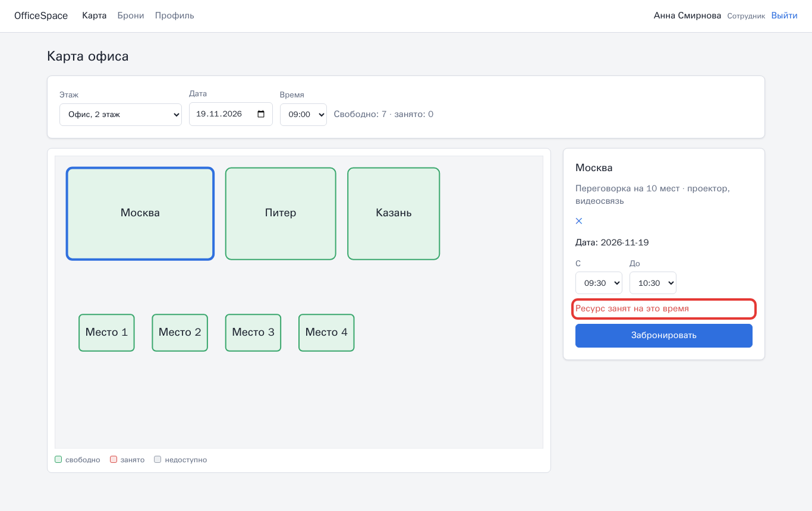

Цифры в сообщениях — текущие правила офиса; их меняет АХО в разделе «Правила», поэтому у вас они могут
отличаться от указанных здесь.
